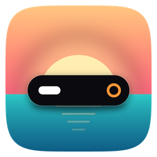
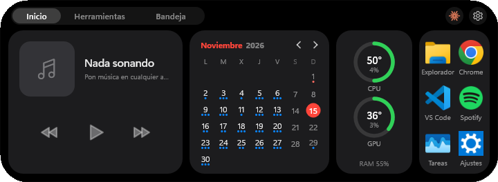
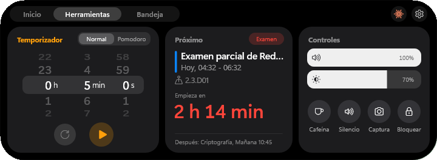
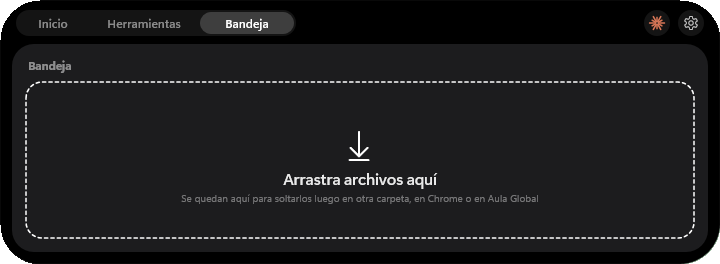

<p align="center"></p>

<h1 align="center">islita</h1>

Una islita dinámica para Windows inspirada en la del iPhone y el Mac: una píldora negra arriba en el centro de la pantalla que enseña la hora y lo importante mientras no la usas, y que se abre con un clic en un panel con música, calendario, temporizador, controles y más.

Está hecha en C++ nativo (Win32 + Direct2D), sin Electron ni .NET, para que consuma lo mínimo: en reposo no gasta CPU medible y usa unos 8 MB de RAM.





## Qué hace

**En reposo**, la píldora muestra la hora, el wifi y el volumen (como en la barra de tareas), la fecha y la batería. Cambia sola según lo que pase:

- Si suena música: carátula, ecualizador con el color de la carátula y el título seguido del artista pasando en bucle con letras de puntitos (como la tipografía del Nothing Phone), sin quitar la hora, el wifi, el volumen, la fecha ni la batería. Al cambiar de canción los puntitos se van encendiendo; en pausa se para. Se desliza de píxel en píxel y en cada paso solo se repinta la franja del texto; solo se mueve con la píldora a la vista.
- Si tienes un evento pronto: "Clase en 20 min".
- Con el temporizador en marcha: la cuenta atrás con un anillo de progreso, también junto al resto de la información. Si además suena música, salen las dos cosas: la carátula y el título pasando a la izquierda y la cuenta atrás a la derecha.
- Al enchufar el cargador: un rayo animado y la batería llenándose hasta el porcentaje real. Mientras está enchufado sale un rayito al lado de la batería.
- Si la ventana que estás usando queda debajo de la isla (por ejemplo, maximizada), se encoge a una rayita fina para no tapar nada. Al pasar el ratón por arriba vuelve.
- Mantén **Ctrl** con el ratón encima para que casi desaparezca y deje pasar los clics a lo que hay debajo.

**El dock**: abajo en el centro hay un dock fino de cristal translúcido, minimalista, como el del Mac, que sustituye a la barra de tareas de Windows:

- El botón de Inicio abre el menú Inicio de Windows, que sale justo encima del dock; con Inicio abierto el dock se queda a la vista (clic derecho: el buscador de apps de la isla).
- Primero tus apps fijadas y, tras una rayita, las demás que tengas abiertas. Las abiertas llevan un puntito debajo (uno por ventana, hasta tres; más claro en la que estás usando).
- Al pasar el ratón los iconos se agrandan como una lupa y sale el nombre encima; al rato, sus ventanas en miniatura y en directo. Da tiempo a subir el ratón hasta ellas y pulsar la que quieras; la que tiene el ratón encima lleva una X para cerrarla (las demás siguen a la vista).
- Clic en una abierta: va a su ventana (si ya estaba delante, se minimiza). Si tiene varias se abre una carpeta con sus ventanas numeradas: clic o el número en el teclado (Esc la cierra). Clic en una fijada cerrada: se abre y el icono va dando saltos hasta que sale su ventana. Botón de la rueda: otra ventana nueva.
- Clic derecho: solo el menú, para abrir otra ventana, fijar o quitar del dock y cerrar.
- Si una app pide atención (parpadea), su icono salta.
- Cuando la ventana que estás usando lo tapa (por ejemplo, maximizada) se esconde hacia abajo; para sacarlo, lleva el ratón al borde de abajo. En pantalla completa desaparece.
- Las apps que entran y salen lo hacen animadas, y el dock solo se dibuja cuando algo cambia: en reposo no gasta nada.

**Al hacer clic** en la isla se abre un panel con tres pestañas. La hora, la fecha, los títulos y los números grandes van en letras de puntitos, a juego con la marquesina de la música (cada texto se dibuja una vez y se reutiliza, así que no gasta más):

- **Inicio**
  - Música de cualquier app (Spotify, YouTube en el navegador, el reproductor de Windows...) con anterior, pausa y siguiente. El título va quieto y grande en puntitos (en dos líneas si es largo) y el artista pequeño debajo. Un clic en la carátula abre la app donde está sonando (en el navegador, la ventana de la canción).
  - Calendario del mes con puntos en los días con eventos; al pulsar un día ves su agenda.
  - Temperatura y uso de CPU y GPU, y la RAM.
- **Herramientas**
  - Temporizador con ruleta como la del iPhone y modo Pomodoro (25 min de enfoque, 5 de descanso y 15 cada cuatro).
  - "Próximo": cuenta atrás hasta tu siguiente clase o evento, con aviso si es un examen o una entrega.
  - Volumen y brillo. Al cambiar el volumen suena un "pop" corto con el volumen nuevo. La flechita de la derecha del volumen elige la salida de sonido (altavoces, cascos, monitor...), como en la barra de tareas.
  - Wi-Fi y Bluetooth, como en el panel rápido de Windows: pulsar los enciende o apaga y la flechita abre la lista. En la de wifi te conectas a las redes guardadas con un clic (las nuevas abren el panel de Windows para la contraseña). En la de Bluetooth, los cascos y altavoces emparejados se conectan y desconectan con un clic.
  - Accesos rápidos: cafeína (que no se apague la pantalla), silencio, captura de pantalla y bloquear.
- **Bandeja**
  - Arrastra archivos encima de la isla y quedan guardados para soltarlos después en otra carpeta o en una web.
  - Al sacarlos se copian; el original nunca se mueve.

En la cabecera hay un botón con el **logo de Windows** que abre el buscador de aplicaciones:

- Busca entre todas las apps del menú Inicio (las de escritorio y las de la Store) mientras escribes. No hace falta poner tildes, y vale con las iniciales ("vsc" encuentra Visual Studio Code).
- Clic o **Enter** para abrirla. Flechas para moverte, **Esc** para borrar o salir.
- El **+** de cada resultado (o **Ctrl+Enter**) la fija en el dock; si ya está, sale un check y al pulsarlo se quita.

Al lado está la flechita de **Segundo plano**: los iconos de las apps que siguen abiertas sin ventana (los de la flechita que hay junto a la hora en la barra de tareas), para cuando la barra está oculta. Clic para abrir la app y clic derecho para su menú, igual que en la barra (la isla se aparta para que el menú quede siempre encima). islita los recoge sin quitárselos a Windows: la barra de tareas los sigue teniendo todos.

También está el botón para abrir **Claude Code** en una terminal y un engranaje con los **ajustes**:

- Iniciar con Windows y abrir al pasar el ratón.
- Dock en vez de la barra: enseña el dock y oculta la barra de tareas de Windows del todo. Las ventanas maximizadas ocupan toda la pantalla, y la tecla Windows, Alt+Tab y las notificaciones siguen funcionando. Al apagarlo o cerrar islita la barra vuelve tal y como estaba.
- Ocultar en pantalla completa y modo rayita.
- Tamaño (3) y color de acento (6).
- Transparencia del fondo (también la del dock), siempre o según dónde esté el ratón.
- Avisos del calendario y con cuánta antelación.

## Instalación

1. Descarga `islita.exe` de la última versión en [Releases](../../releases).
2. Ponlo en una carpeta fija (por ejemplo `%LOCALAPPDATA%\Programs\islita`) y ábrelo.

La primera vez se añade sola al inicio de Windows; se puede quitar en los ajustes. Para cerrarla: ajustes → "Salir de la isla".

Como el ejecutable no está firmado, Windows puede avisar con "Windows protegió su PC". Pulsa "Más información" y luego "Ejecutar de todas formas".

**Requisitos:**

- Windows 11, por las fuentes Segoe UI Variable y Segoe Fluent Icons. En Windows 10 funciona, pero con otra letra y sin algunos iconos.
- La temperatura y el uso de la GPU se leen como en el Administrador de tareas (sale con las gráficas que lo informan, como NVIDIA). La de la CPU es la del sensor térmico de la placa, sin permisos de administrador.
- El brillo solo funciona con la pantalla interna de un portátil.

## Configuración

Todo se guarda en tu usuario. No hay nada que configurar dentro de la carpeta del programa.

| Qué | Dónde |
|---|---|
| Apps fijadas en el dock (hasta 36) | `%APPDATA%\islita\atajos.txt`, una línea por app: `Nombre \| ruta \| icono opcional \| argumentos opcionales` |
| Calendarios | `%APPDATA%\islita\calendarios.txt`, una línea por calendario: `Nombre \| dirección iCal` |
| Bandeja | `%APPDATA%\islita\bandeja.txt` (solo rutas, no copias de los archivos) |
| Ajustes | Registro, `HKCU\Software\islita` |

Los dos archivos de texto se abren también desde los ajustes ("Editar apps del dock" y "Editar calendarios").

**Conectar Google Calendar:**

1. Entra en calendar.google.com → Configuración → tu calendario → "Integrar el calendario".
2. Copia la **dirección secreta en formato iCal** y pégala en `calendarios.txt`.

Esa dirección da acceso de lectura a tu calendario, así que no la compartas. islita solo la guarda en tu ordenador. Por defecto viene el calendario público de festivos de España.

## Privacidad

- islita no envía nada a ningún sitio.
- La única conexión a internet es la descarga de los calendarios que tú añadas, cada 15 minutos.
- La música, las temperaturas y el resto de datos se leen de Windows en tu propio equipo.

## Consumo

- El panel solo se redibuja cuando cambia algo; en reposo, una vez por minuto para la hora.
- El hilo de fondo va en modo eficiencia de Windows (EcoQoS) y con prioridad mínima.
- Los sensores, el control de volumen y el brillo solo se activan con el panel abierto.
- El wifi y el volumen de la píldora se actualizan por avisos de Windows, sin consultar cada poco: solo se redibuja si cambian las barras, la conexión o el icono del volumen.
- Las animaciones van al ritmo de la pantalla (máximo unos 75 fotogramas por segundo).

## Compilar

Hace falta [MSYS2](https://www.msys2.org/) con el compilador UCRT64 (`pacman -S mingw-w64-ucrt-x86_64-gcc`). Después:

```powershell
.\build.ps1
```

`build.ps1` compila `islita.cpp` en `islita.exe` y lo copia a `%LOCALAPPDATA%\Programs\islita`. Todo el programa está en un único archivo, `islita.cpp`; el icono y los datos de versión, en `islita.rc` y `assets/`.

## Licencia

MIT. Hecho con ayuda de Claude.
